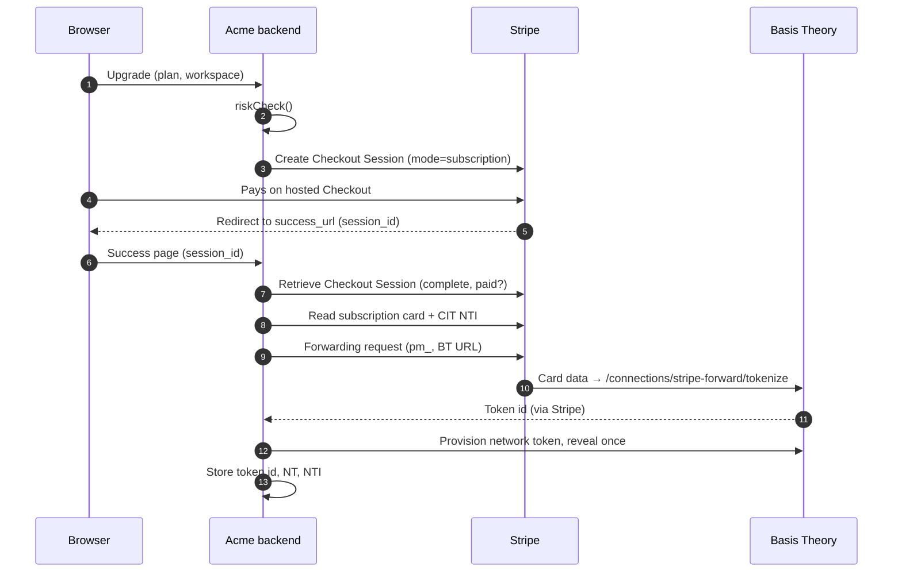
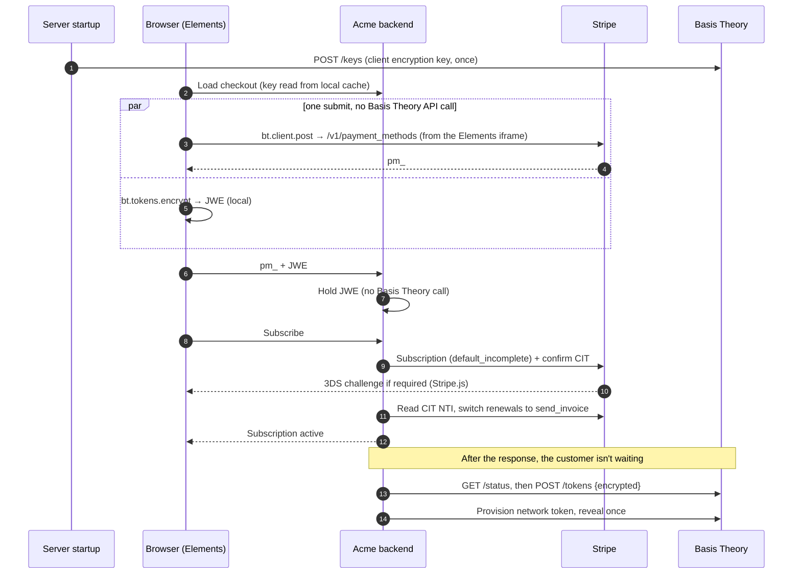
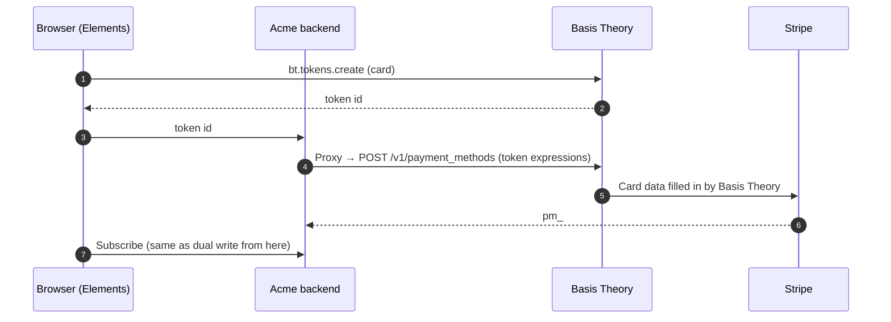
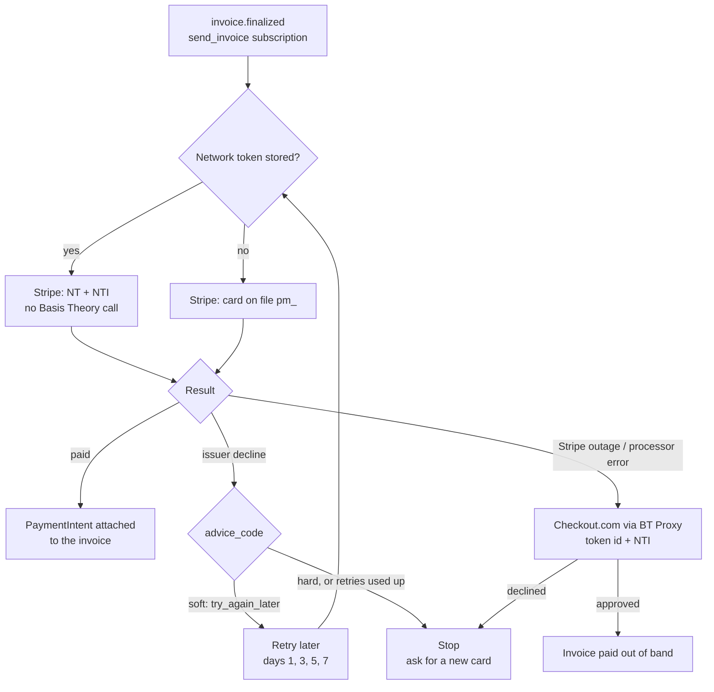

# Acme Builder · Vault-first payments POC

A subscription SaaS ("Acme Builder") that moves card ownership into a [Basis Theory](https://basistheory.com) vault in steps, without changing Stripe Billing, the risk check in front of checkout, or Stripe's fraud tooling.


| Step            | What changes                                                                                                                            | What stays the same                                                    |
| --------------- | --------------------------------------------------------------------------------------------------------------------------------------- | ---------------------------------------------------------------------- |
| **Quick Start** | After each Stripe Checkout subscription, the card is forwarded from Stripe to the vault and a network token is provisioned.             | Hosted Stripe Checkout, Billing, wallets, the customer experience.     |
| **Phase 1(a)**  | Own checkout page: cards through Basis Theory Elements (two write modes), wallets and other methods through Stripe Elements.            | Stripe Billing (plans, invoices), Stripe 3DS, Radar, non-card methods. |
| **Phase 1(b)**  | Renewals are charged by the merchant: Stripe with the network token first, Checkout.com through the Basis Theory Proxy if Stripe fails. | Billing stays the system of record (Stripe charges attached to the invoice; Checkout.com charges paid out of band).        |
| **Phase 2**     | Migration dry run: Stripe card export in, the same file back with vault tokens and network tokens.                                      | Nothing in production.                                                 |

A rollout flag moves workspaces from Quick Start to Phase 1 by percentage or by country.

### Options at a glance


|                                   | Quick Start (forward)                                         | Phase 1 · dual write                                                      | Phase 1 · proxy                                           |
| --------------------------------- | ------------------------------------------------------------- | -------------------------------------------------------------------------- | ---------------------------------------------------------- |
| Build                             | Success-page handler + one Stripe API call                    | New checkout page (cards); Stripe Elements for the rest                    | Same page; backend Proxy call instead of the browser write |
| Maintain                          | Nothing in checkout changes                                   | Card form + encryption key rotation + reconciler                           | Card form                                                  |
| Basis Theory in the checkout path | No                                                            | No (card goes to Stripe directly, vault copy can wait)                     | Yes                                                        |
| Who captures the card             | Stripe                                                        | You (Elements)                                                             | You (Elements)                                             |
| Gaps                              | Cards saved through Link are not forwarded; CVC usually gone  | Needs Stripe raw card data APIs;`api.stripe.com` on the Elements allowlist | Needs Stripe raw card data APIs                            |
| Cost drivers                      | Stripe forwarding fee per card; vaulted cards; network tokens | Vaulted cards; network tokens                                              | Vaulted cards; network tokens; Proxy calls                 |

Renewals (all options): Stripe with the network token, the Stripe `pm_` when there is no network token, Checkout.com through the Proxy when Stripe fails.

---

## Quick Start · Stripe Checkout + Forward



Code: [`lib/quick-start/`](lib/quick-start). Postman: requests **0.1 – 0.5**.

No webhooks. Stripe redirects to `success_url` with `{CHECKOUT_SESSION_ID}`, and the success page asks the backend to fulfill that session. The backend retrieves it from Stripe and only continues when it is `complete` and not `unpaid` ([Stripe: trigger fulfillment from your landing page](https://docs.stripe.com/checkout/fulfillment)). The page renders straight away; the work runs after the response and shows in the step log.

Stripe notes that customers don't always reach the landing page (closed tab, lost connection). The backstop is [`sweepCompletedCheckouts()`](lib/quick-start/sweep.ts): every 30s it lists `checkout.session.completed` and `checkout.session.async_payment_succeeded` events (the second covers methods that settle later) from the [Events API](https://docs.stripe.com/api/events/list) (last 24h, older than 2 minutes so fresh ones stay with the success page) and fulfills any session that wasn't. Both triggers call the same [`fulfillCheckoutSession()`](lib/quick-start/forward.ts), which records each session in `checkout_fulfillments` so a card is forwarded once. `/ops` has a button to run the sweep on demand.

Forwarding needs Vault and Forward enabled on the Stripe account. Until then Stripe answers `forwarding_api_inactive`: the step log says `stripe.forward rejected: Stripe account can't forward cards`, and the subscription itself is unaffected.

Cards saved through Link are excluded from Stripe forwarding; they are skipped and logged.

## Phase 1(a) · Own checkout

One page, two collectors:

- **Card · Basis Theory**: Elements card fields, in one of two write modes (`PHASE1_CARD_WRITE`, switchable on `/ops`).
- **Wallets and other methods · Stripe**: Express Checkout Element (Apple Pay / Google Pay) and Payment Element showing every method enabled in the Stripe Dashboard except card (e.g. Pix for BRL workspaces). These create a `pm_` and stay at Stripe; their subscriptions renew on Billing as usual. Moving wallets to Basis Theory is a later step.

In every case the browser only creates a `pm_` (`POST /v1/payment_methods`); the backend creates the subscription and confirms the intent.

### Card write mode `dual-write` (default)



The customer only waits for Stripe. The backend holds the JWE in `pending_encrypted_cards` during checkout and releases it once the subscription is active; [`vaultCredential()`](lib/phase-1/reconcile.ts) then creates the token and the network token after the response (Next.js `after()`). In proxy mode the token already exists, so only the network token runs afterwards.

- **Basis Theory down:** the JWE stays queued and [`reconcilePending()`](lib/phase-1/reconcile.ts) (every 30s, or **Run reconciler** on `/ops`) vaults it when the vault is back. It's also the retry if the background run fails.
- **Checkout never completes** (declined, abandoned): the held JWE is never vaulted and is deleted after an hour.

### Card write mode `proxy`



The same pattern adds any other PSP (see the Checkout.com failover). Tradeoff: Basis Theory is in the checkout path, so if it's down, cards can't be collected; the page says so when "Simulate Basis Theory down" is on.

Code: [`app/phase-1/checkout/`](app/phase-1/checkout), [`lib/phase-1/`](lib/phase-1), [`lib/stripe-proxy.ts`](lib/stripe-proxy.ts). Postman: **1.1 – 1.6**.

## Phase 1(b) · Renewals with Checkout.com failover



Code: [`lib/phase-1/renewals.ts`](lib/phase-1/renewals.ts), [`lib/phase-1/dunning.ts`](lib/phase-1/dunning.ts), [`lib/checkoutcom.ts`](lib/checkoutcom.ts). Postman: **2.1 – 2.6**.

- The first network token charge starts its own transaction chain with a cryptogram; later charges reference that chain's NTI.
- **Settling the invoice.** When Stripe charges (network token or `pm_`), the PaymentIntent is attached to the invoice with [`attach_payment`](https://docs.stripe.com/api/invoices/attach_payment), so Billing records a normal Stripe payment. Only a Checkout.com charge is recorded as paid out of band; it shows as a payment record on the invoice.
- **Declines.** An issuer decline never goes to Checkout.com. Stripe's `advice_code` decides what happens next ([Stripe: declined card retries](https://docs.stripe.com/declines/card)):
  - `try_again_later` is a soft decline. The renewal is retried 1, 3, 5 and 7 days after the first decline, each time from the top of the ladder. [`retryDueRenewals()`](lib/phase-1/dunning.ts) runs due retries every 30s; on `/ops`, **Process renewal** runs the next one straight away for test-clock demos.
  - `do_not_try_again` and `confirm_card_data` are hard declines, and so is a soft decline after four retries (card networks limit reattempts). The renewal stops; asking the customer for a new card and cancelling are product decisions left to you.
  - Without an `advice_code`, `decline_code` decides (`lost_card`, `stolen_card`, `expired_card` and similar are hard).
  - Checkout.com declines are not classified in this POC and stop.
- Subscriptions with `PHASE1_RENEWALS=stripe-native` (or cards that were never vaulted) are not orchestrated: Billing charges them itself and runs Smart Retries.
- Renewals are driven by Stripe test clocks. On `/ops`, use **+1 month** then **Process renewal** (or run `yarn stripe:listen:phase-1` to receive real webhooks, see Setup step 4).
- To see a soft decline, click **Next renewal declines (soft)** on `/ops` for a workspace, then **+1 month** and **Process renewal**. It makes Stripe's `4000 0000 0000 0341` the card on file (it saves fine, then declines with `try_again_later`) and sets the network token aside so the renewal reaches that card. Each further **Process renewal** runs the next retry until they run out. Turn off *Simulate Stripe down* first, or the renewal fails over instead. Stripe's lost, stolen and expired test cards are refused when saved, so hard declines are covered by unit tests.

## Phase 2 · Migration dry run

Two steps, the same ones a managed migration runs:

1. **Import.** Each row of the Stripe export is tokenized; the output is the same file with `card.number` replaced by the vault token id, plus card details.
2. **Network token backfill.** The step 1 output goes through network token provisioning and comes back with seven columns appended. `network_token_provisioning_status` is `created`, `deduplicated`, `failed`, `token_not_found` or `skipped`; token fields are filled only on `created`/`deduplicated`, and a reason only on the other three.

```bash
yarn migration:dry-run --mock   # offline, deterministic
yarn migration:dry-run          # real Basis Theory sandbox
```


| File                                                                   | Contents                                                                                                                                                                                                               |
| ---------------------------------------------------------------------- | ---------------------------------------------------------------------------------------------------------------------------------------------------------------------------------------------------------------------- |
| [`samples/stripe-export.sample.csv`](samples/stripe-export.sample.csv) | Stripe card export (test cards only, including network token sandbox success and error cards)                                                                                                                          |
| [`samples/output/*.import-output.csv`](samples/output)                 | Same rows,`card.number` replaced by the vault token id, plus brand, bin, last4, funding, fingerprint                                                                                                                   |
| [`samples/output/*.nt-backfill-output.csv`](samples/output)            | Step 1 output plus`network_token`, `bt_network_token_id`, `network_token_exp_month`, `network_token_exp_year`, `network_token_status`, `network_token_provisioning_status`, `network_token_provisioning_failed_reason` |

The committed outputs come from `--mock`, which returns what the network token sandbox returns for these cards.

---

## Setup

### 1. Prerequisites

- Node.js 24 (`nvm use` reads `.nvmrc`)
- Yarn 1.x
- Optional: [Stripe CLI](https://docs.stripe.com/stripe-cli) (`stripe login`), only to receive Phase 1 renewal webhooks locally

### 2. Accounts and keys

All sandbox / test mode. The app refuses to start with a live Stripe key.

**Stripe** (test mode)


| Key                                                 | Where                               |
| --------------------------------------------------- | ----------------------------------- |
| `STRIPE_SECRET_KEY` (`sk_test_…`)                  | Dashboard → Developers → API keys |
| `NEXT_PUBLIC_STRIPE_PUBLISHABLE_KEY` (`pk_test_…`) | same                                |
| `STRIPE_WEBHOOK_SECRET` (`whsec_…`, optional)      | printed by`stripe listen` (step 4)  |

Account features to request from Stripe (support or your account team), by flow:


| Feature                                            | What it unlocks                                                                                                                                                                                                                                                                                                        | How to request                                                                                                                                  | Without it                                                                                                                                                                                                        |
| -------------------------------------------------- | ---------------------------------------------------------------------------------------------------------------------------------------------------------------------------------------------------------------------------------------------------------------------------------------------------------------------- | ----------------------------------------------------------------------------------------------------------------------------------------------- | ----------------------------------------------------------------------------------------------------------------------------------------------------------------------------------------------------------------- |
| Raw card data APIs                                 | Phase 1 card checkout, both write modes (`POST /v1/payment_methods` with card numbers)                                                                                                                                                                                                                                 | Stripe support;[no paperwork in test mode](https://support.stripe.com/questions/enabling-access-to-raw-card-data-apis), PCI attestation in live | Phase 1 cards can't create the`pm_`; Quick Start, Stripe methods and renewals still work                                                                                                                          |
| Vault and Forward                                  | Quick Start: forward the saved card to`api.basistheory.com/connections/stripe-forward/tokenize`                                                                                                                                                                                                                        | Stripe account team,[even in test mode](https://docs.stripe.com/payments/vault-and-forward)                                                     | Stripe answers`forwarding_api_inactive`. The step log says `stripe.forward rejected: Stripe account can't forward cards`; the subscription still works, the card just isn't vaulted                               |
| Network token charges with your own network tokens | Renewals charged with the stored network token:`payment_method_data[card][network_token][number|exp_month|exp_year]`, with `payment_method_options[card][network_token][cryptogram|electronic_commerce_indicator]` on the first charge and `payment_method_options[card][mit_exemption][network_transaction_id]` after | Stripe account team (not self-serve)                                                                                                            | Stripe answers`parameter_missing: payment_method_data[card][number]`. The step log says `stripe.nt rejected: Stripe account can't charge network tokens` and the renewal falls back to the card on file at Stripe |

**Basis Theory** (test tenant). Create two applications in the [portal](https://portal.basistheory.com):


| Application               | Type    | Permissions                                                                                                                                                   | Env var                                            |
| ------------------------- | ------- | ------------------------------------------------------------------------------------------------------------------------------------------------------------- | -------------------------------------------------- |
| Elements                  | Public  | `token:create`                                                                                                                                                | `NEXT_PUBLIC_BT_PUBLIC_API_KEY`                    |
| Backend                   | Private | `token:create`, `token:read`, `proxy:invoke`, `keys:create`, `network-token:create`, `network-token:read`, `network-token:reveal`, `network-token:cryptogram` | `BT_PRIVATE_API_KEY`                               |
| Stripe Forward (optional) | Private | `token:create`                                                                                                                                                | `BT_FORWARD_API_KEY` (defaults to the Backend key) |

Network tokens must be enabled on the tenant (otherwise provisioning returns "Feature Unavailable" and renewals use the Stripe `pm_`). Phase 1 also needs `api.stripe.com` on the Elements HTTP client allowlist (ask Basis Theory support).

**Checkout.com** (sandbox, for the renewal failover only)


| Key                         | Notes                                                                    |
| --------------------------- | ------------------------------------------------------------------------ |
| `CKO_SECRET_KEY`            | `sk_sbox_…`                                                             |
| `CKO_PROCESSING_CHANNEL_ID` | `pc_…`                                                                  |
| `CKO_API_URL`               | your sandbox prefix URL, e.g.`https://<prefix>.api.sandbox.checkout.com` |

### 3. Install and configure

```bash
yarn install
cp .env.example .env.local   # fill in the keys above
yarn setup:sandbox           # checks the BT keys, creates Stripe products/prices by lookup key
```

Prices are created per plan and currency (`pro_monthly_usd`, `pro_monthly_brl`, `starter_monthly_eur`, ...), the same lookup-key pattern the checkout uses.

### 4. Webhooks (optional, Phase 1 renewals only)

Quick Start doesn't use webhooks (see above). To drive Phase 1 renewals from Stripe events instead of the `/ops` buttons:

```bash
yarn stripe:listen:phase-1       # invoice.finalized → merchant-orchestrated renewals
```

It prints a `whsec_`; put it in `STRIPE_WEBHOOK_SECRET` and restart `yarn dev`. Without it, use `/ops`: **+1 month**, then **Process renewal**.

### 5. Run

```bash
yarn dev
```

On startup the server creates the client encryption key and schedules the reconciler and the Quick Start checkout sweep; all show in the terminal step log.

- `/` pricing → checkout (rollout flag, or force a phase)
- `/ops` switches (simulate Basis Theory or Stripe down, forwarding mode, NT charges, Phase 1 card write mode, Stripe methods, rollout % and countries), renewals, credentials and the step log

Test cards:


| Card                  | Stripe test mode | BT network token sandbox                                            |
| --------------------- | ---------------- | ------------------------------------------------------------------- |
| `4000 0000 0000 0093` | succeeds         | provisions a network token (use this to see the full chain)         |
| `4242 4242 4242 4242` | succeeds         | provisioning fails (`CARD_DECLINED`), renewals use the Stripe `pm_` |
| `4000 0027 6000 3184` | 3DS challenge    |                                                                     |
| `4000 0000 0000 9995` | declined         |                                                                     |

Stripe test mode only accepts its own test cards, and the network token sandbox only provisions its own; `4000 0000 0000 0093` is on both lists.

### 6. Verify

```bash
yarn test:unit                  # offline
yarn test                       # plus scenario tests for whichever keys are set
yarn migration:dry-run --mock   # Phase 2 sample outputs
```

Postman: import `postman/acme-builder.postman_collection.json` and `postman/acme-builder.postman_environment.json`, fill in the keys, run the folders in order.

## Tests

```bash
yarn test        # unit tests always run; scenario tests run when their sandbox keys are set
yarn test:unit
```

Each scenario test sets up its own starting point through the APIs (for example, a Stripe customer with a paid subscription stands in for a completed Checkout) and then runs one step.


| Test                            | Covers                                                                                                                                                 | Needs                                             |
| ------------------------------- | ------------------------------------------------------------------------------------------------------------------------------------------------------ | ------------------------------------------------- |
| `unit/renewal-ladder`           | NT → pm_ → Checkout.com ladder, decline handling, chain start                                                                                        | nothing                                           |
| `unit/bt-down`                  | No Basis Theory call at checkout; vaulting after the subscription, BT down, once-only, abandoned blobs dropped                                       | nothing                                           |
| `unit/migration`                | Output columns, PAN replacement, NT file contract, Stripe ids kept per row                                                                             | nothing                                           |
| `unit/requests`, `unit/rollout` | Forward body, Proxy body, rollout split                                                                                                                | nothing                                           |
| `scenarios/quickstart-forward`  | Stripe card → vault token → network token                                                                                                            | Stripe, BT                                        |
| `unit/phase1-intake`            | Proxy request body, proxy and Stripe-method intake, non-vaulted renewals stay on Billing                                                               | nothing                                           |
| `scenarios/phase1-dual-write`   | pm_ + JWE, healthy and down                                                                                                                            | Stripe (raw card APIs), BT                        |
| `scenarios/phase1-proxy`        | BT token → Proxy → Stripe pm_                                                                                                                        | Stripe (raw card APIs), BT                        |
| `scenarios/phase1-3ds`          | CIT challenge, decline on save, decline on charge                                                                                                      | Stripe                                            |
| `scenarios/renewals`            | Test-clock renewal: card on file, NT path (real provisioning, cryptogram and Stripe NT charge or its logged rejection), decline, Checkout.com failover | Stripe, BT (network tokens enabled), Checkout.com |

## Real vs simulated


| Piece                                                      | Status                                                                                                                       |
| ---------------------------------------------------------- | ---------------------------------------------------------------------------------------------------------------------------- |
| Stripe Checkout, Billing, test clocks, 3DS, invoices       | Real (test mode)                                                                                                             |
| Stripe Forwarding API                                      | Real call. Fails on Stripe accounts without Vault and Forward (logged reason); see Setup                                     |
| Elements → Stripe`payment_methods` (dual write)           | Real call from the Elements iframe (Elements 3.7.0+, expiry sent as`month()`/`year()`)                                       |
| Basis Theory Proxy → Stripe`payment_methods` (proxy mode) | Real                                                                                                                         |
| Stripe Express Checkout / Payment Element                  | Real; methods shown depend on the Stripe account                                                                             |
| Client-side encryption,`POST /tokens {encrypted}`          | Real                                                                                                                         |
| Network token provisioning                                 | Real sandbox (simulated network values)                                                                                      |
| Stripe charge with a network token                         | Real call. Fails on Stripe accounts without network token charges (logged reason, falls back to the card on file); see Setup |
| Basis Theory Proxy → Checkout.com                         | Real (sandbox)                                                                                                               |
| "Basis Theory down" / "Stripe down"                        | Switches on`/ops`                                                                                                            |

## Before going live

- Stripe: Forwarding (Vault and Forward) enabled on the account; raw card data APIs (PCI attestation required in live mode); network token passthrough on PaymentIntents.
- Basis Theory: `api.stripe.com` allowlisted for the Elements HTTP client; network tokens enabled for the tenant.
- PCI: confirm with your QSA how storing revealed network tokens and receiving Stripe's PaymentMethod response in the browser affect scope.
- Checkout.com: confirm it accepts the Stripe-originated NTI in `previous_payment_id`.

## Layout

```
app/                    pages + API routes (quick-start/, phase-1/, ops/)
lib/quick-start/        Checkout session, forward to vault
lib/phase-1/            card intake, subscribe (CIT/3DS), reconciler, renewals
lib/bt.ts               Basis Theory: status, tokens, network tokens, keys, proxy
lib/stripe.ts           Stripe client (test mode only), error classification
lib/stripe-proxy.ts     Stripe pm_ from a vaulted card through the Proxy
lib/checkoutcom.ts      Checkout.com MIT through the Proxy
lib/migration.ts        export → import output (step 1) → NT backfill (step 2)
lib/log.ts              step logger (terminal + /ops feed)
instrumentation.ts      startup: encryption key + reconciler timer
AGENTS.md               brief for coding agents working in this repo
postman/                collection + environment (yarn postman:build)
samples/                migration input and outputs
tests/                  unit/ (offline) and scenarios/ (sandbox)
```
